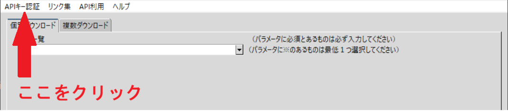
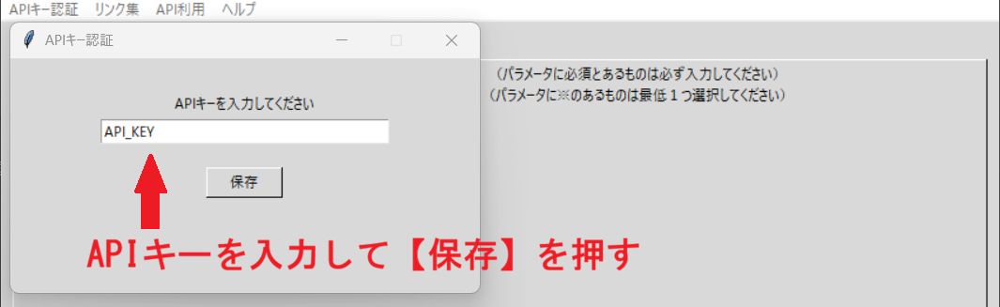
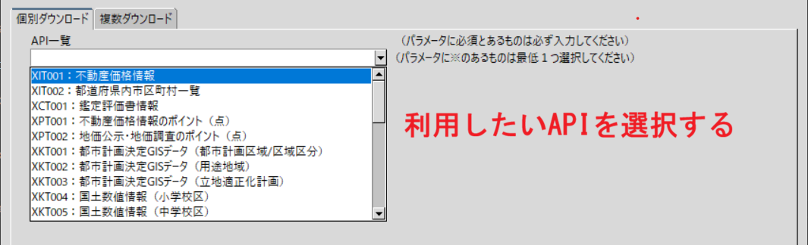
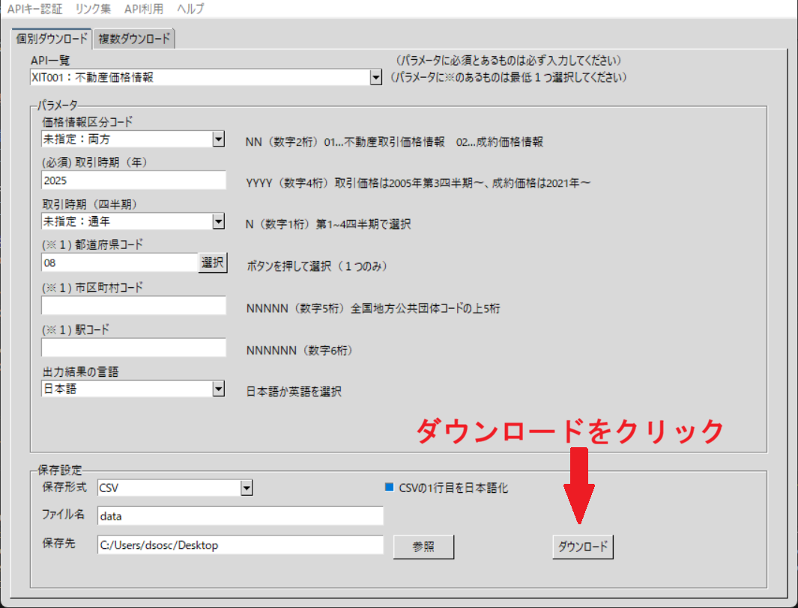
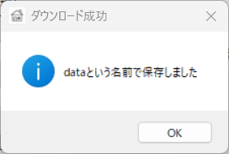
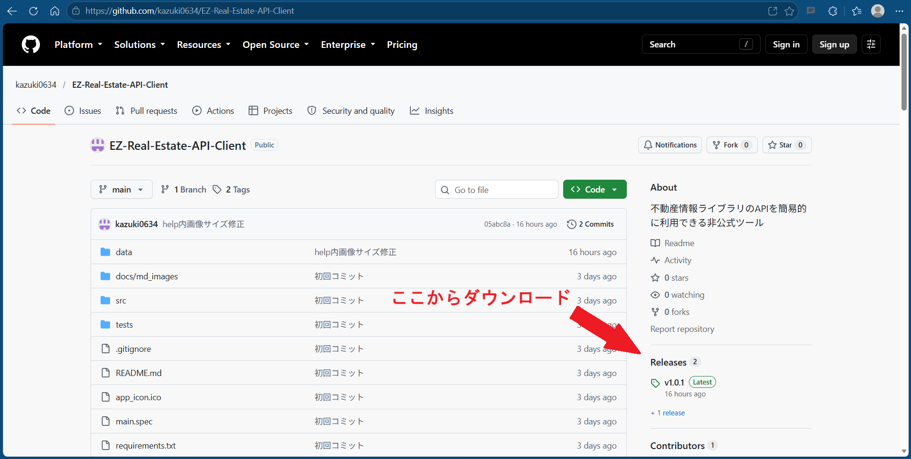

# EZ Real Estate API Client

国土交通省の[不動産情報ライブラリ](https://www.reinfolib.mlit.go.jp/)で公開されているAPIをGUI操作で利用できるアプリケーションです。

## 概要
+ 利用したいAPIの選択
+ 各種パラメータの入力
+ 保存形式（CSV, PBF, GeoJSONなど）、ファイル名や保存先の設定  
+ 複数APIのデータのマージ

これらをGUI上で行うことができます。

## 利用手順
＊事前に[API利用申請](https://www.reinfolib.mlit.go.jp/api/request/)からAPIの利用申請をし、APIキーを取得してください。

1.左上の**APIキー認証**をクリック  

2.事前に取得したAPIキーを入力して保存をクリック（最初の１回のみ）  

3.利用したいAPIを選択  

4.各種パラメータ、ファイルの保存形式などを選択したら左下の**ダウンロード**をクリック  

5.メッセージが出たら保存完了  

## ダウンロード方法
このページのReleasesから最新の`EZ_RealEstate_API_Client.zip`をダウンロードして展開してください。 

## 起動方法
展開後のフォルダ内にある`main.exe`をクリックすると起動できます。  
（移動したいときは、同梱されている`data`フォルダを必ずexeファイルと同じフォルダに配置してください）

## 利用上の注意 
このサービスは、国土交通省の不動産情報ライブラリのAPI機能を使用していますが、提供情報の最新性、正確性、
完全性等が保証されたものではありません。

## 使用技術
+ python 3.14.3
+ tkinter 8.6
+ requests 2.34.2
+ pandas 3.0.5
+ PyInstaller 6.22.2

## お問い合わせ・不具合報告

本アプリケーションに関する不具合の報告や改善要望については、以下のメールアドレスまでお問い合わせください。

Kazu0634.dev@gmail.com

※ 報告の内容によっては、対応できない場合があります。
